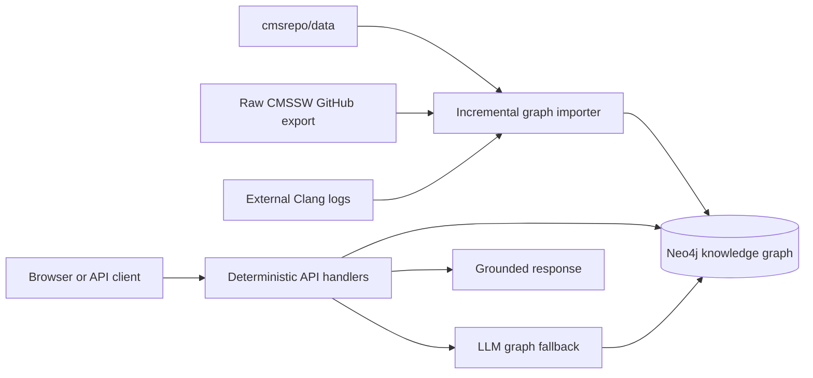

# CMSSDT Knowledge Graph Chatbot

## Purpose

The CMSSDT Knowledge Graph Chatbot answers questions about CMSSW Integration
Builds (IBs), RelVals, unit tests, build-status warnings, parsed Clang
diagnostics, and CMSSW GitHub discussions. It imports these sources into Neo4j
and exposes a chat API at `POST /api/chat`.

## Plain-Language Overview

This project is a searchable, evidence-based assistant for CMSSW development
data. It gathers information that would otherwise be spread across build
reports, compiler logs, GitHub discussions, and test results. It organizes that
information in one connected database so that a user can ask a direct question
and receive an answer linked to imported records.

Think of the pipeline as a four-step workflow:

1. **Collect** build, test, compiler, and GitHub information from their source
  systems.
2. **Organize** the information consistently and update only the parts that
  changed since the last import.
3. **Connect** related facts in Neo4j, such as a build and its architecture, or
  an Issue and its comments.
4. **Answer** questions through an API. Common questions use fixed, verifiable
  logic; broader questions can use an LLM that is restricted to reading the
  graph.

The chatbot reports what the imported records say. It does not turn a GitHub
mention, an approval, or a warning into an unsupported claim about cause,
ownership, or a fix.

## System Flow



The pipeline has four stages:

1. **Source data** supplies build results, GitHub discussions, and Clang logs.
2. **Incremental ingestion** converts those sources into graph records.
3. **Neo4j** stores queryable facts and explicit relationships.
4. **The chat API** first recognizes precise questions, then falls back to an
   LLM that can use read-only graph tools for questions that do not match a
   deterministic handler.

## Technical Architecture

### Components and responsibilities

| Component | Responsibility | Primary output |
| --- | --- | --- |
| `cmsrepo/data` | Provides structured IB, RelVal, unit-test, queue-summary, and aggregate PR data | Build and test source records |
| Raw GitHub export | Provides Issues, PRs, comments, authors, and labels | Discussion source records |
| External Clang logs | Provides compiler diagnostic details not present in queue summaries | Warning locations and occurrences |
| `ingestion/build_graph.py` | Hashes, normalizes, imports, replaces, and reconciles source-owned records | Neo4j nodes and relationships |
| Neo4j | Stores durable connected facts and serves read-only graph queries | Queryable knowledge graph |
| `server/api_server.py` | Accepts chat requests and routes them to deterministic handlers or the fallback | Grounded JSON response |
| `server/agent.py` and `graph/tools.py` | Lets the fallback ask constrained, read-only graph questions | Evidence-backed fallback answer |

### Data flow for engineers

1. The importer discovers files from the configured CMS repository, GitHub
  export, and Clang-log root.
2. It calculates a content hash for each source unit and checks its
  `ImportState`. Unchanged units are skipped; changed units have their
  source-owned graph facts replaced. `--reconcile` removes facts for sources
  that disappeared.
3. The importer normalizes source records into stable graph identities. An IB
  identity uses both the timestamped tag and architecture, represented as
  `<tag>:<arch>`, so two compiler platforms cannot overwrite each other.
4. Neo4j stores nodes and explicit relationships for build results, test data,
  Clang diagnostics, and GitHub discussions.
5. `POST /api/chat` applies intent-specific handlers before the LLM fallback.
  Those handlers execute focused Cypher queries and format the result with its
  evidence limits. The fallback receives only read-only graph tools.

### Query execution and trust boundary

The deterministic route is preferred whenever a question has a supported,
exact shape, including build-status warning lookups, exact PR facts, and
release-string searches. This produces predictable answers without requiring
language-model interpretation. The LLM fallback is used for broader questions,
but it cannot write to Neo4j and cannot establish facts absent from the graph.

Two warning domains remain intentionally separate throughout the pipeline:

| Domain | Source | Meaning |
| --- | --- | --- |
| CMSSW build-status warnings | Queue-summary `compWarning` fields | Per-IB/per-architecture status counts, including ignored warnings |
| Parsed Clang diagnostics | External `log.html` files | Individual diagnostic locations and occurrences in packages and files |

These values answer different questions and must not be added together or
treated as interchangeable.

## Source Data

### CMSSW build data

`cmsrepo/data` contains the structured data used for IB outcomes, RelVals,
unit tests, queue summaries, and aggregate PR exports. An IB is identified by
both its timestamped tag and architecture. This prevents build facts from one
compiler or platform from overwriting facts from another.

For example, these are distinct IB identities:

```text
CMSSW_20_1_DBG_X_2026-08-07-2300:el9_amd64_gcc13
CMSSW_20_1_DBG_X_2026-08-07-2300:el9_amd64_gcc14
```

### Raw CMSSW GitHub export

A raw export provides `issue.json` and `comments.json` data, either in a
directory or a tar archive. The importer classifies pull requests and ordinary
Issues, imports their authors and labels, and stores discussion comments.

Unlike `cmsrepo` (git submodule, bumped regularly) and the exceptions feed
(refreshed via a routine `--es-exceptions-json` run), **this source has no
automatic refresh** — it drifts until someone manually re-syncs it. Check
staleness before assuming an answer about "the latest Issue/PR" is current.

**Where the live data lives:** `cmssdt9-02.cern.ch`, path
`/data/sdt/SDT/public/github/cms-sw/cmssw/issues` (owned by `cmsbuild`; needs
a `cmsbld`/root shell on that host to read). It's produced by `cms-bot`'s
`github_backup.py`, which is itself incremental — it only re-fetches issues
updated since its own checkpoint. That checkpoint lives at
`issues/latest.txt` on `cmssdt9-02` as a Unix timestamp; decode it to sanity-check
freshness before syncing:

```bash
# on cmssdt9-02
cat /data/sdt/SDT/public/github/cms-sw/cmssw/issues/latest.txt
date -d @<value> -u
```

If that date isn't recent, the upstream backup job hasn't run — syncing won't
add anything new until someone re-runs it there.

**Direct inbound SSH from a normal dev machine to `cmssdt9-02` does not
work** (confirmed: the connection closes mid-GSSAPI-handshake, from both a
direct attempt and via an `lxplus` jump host) — it looks like `cmssdt9-02`
restricts inbound SSH to an allowlist that doesn't include general logins.
The sync has to be **pushed from `cmssdt9-02` outward** instead, which does
work:

```bash
# run this ON cmssdt9-02 (as cmsbld/root), pushing OUT to the chatbot host
rsync -avz --info=progress2 \
  /data/sdt/SDT/public/github/cms-sw/cmssw/issues/ \
  <local-user>@<local-host-ip>:/home/rao/CHAT-BOT-AI/GITHUB-ISSUES/issues/
```

Then, back on the chatbot host, ingest it:

```bash
PYTHONPATH=ingestion NEO4J_URI=bolt://localhost:7688 venv/bin/python ingestion/build_graph.py \
  --cmsrepo cmsrepo \
  --github-issues /home/rao/CHAT-BOT-AI/GITHUB-ISSUES/issues \
  --reconcile
```

Watch the printed `GitHub raw PRs imported: N; issues imported: M; comment
files imported: K` line — since imports are content-hashed per Issue/PR, `N`
and `M` reflect only what actually changed, not the full export size. Verify
in Neo4j afterward if needed:

```cypher
MATCH (i:Issue {repo:'cmssw'}) RETURN max(i.number), count(i)
MATCH (p:PR {repo:'cmssw'}) RETURN max(p.number), count(p)
```

### External Clang logs

Clang diagnostics are kept independently of `cmsrepo` under this layout:

```text
<clang-root>/<ib-tag>/<architecture>/build-logs/**/log.html
```

The parser extracts diagnostic locations and associates them with package,
file, and checker facts.

### IB test logs (cmssdt9-02)

The dashboard data only says whether each test passed. The raw logs on
`cmssdt9-02:/data/sdt/buildlogs/` (`unitTestLogs.zip`, `addOnTests.zip`,
`pyRelValMatrixLogs.zip` per IB, architecture and GPU/other variant) show
what happened inside, and the server deletes them after about one week.

```text
cmssdt9-02 --rsync--> IB-TEST-LOGS/server-copy/ --fetch_ib_test_logs.py--> results/*.json.gz --ingest_test_logs.py--> Neo4j
                                   (deleted once scanned)                  (kept, a few MB/day)
```

- `ib_test_log_scanner.py` reads every log line by line and keeps every
  test/workflow with its status, plus exceptions, crashes, sanitizer
  reports, assertions, tracebacks and infrastructure errors, with the test
  they belong to and whether it passed. Warnings and plain error lines are
  grouped, and debug output is dropped.
- `fetch_ib_test_logs.py` keeps a ledger, so nothing is scanned twice. It
  keeps the local copy of a zip that failed and retries it, and at the end
  lists every zip the dashboard expects that was never scanned.
- `ingest_test_logs.py` stores `TestLogRun`, `LogProblem`,
  `ProblemSignature` and `ProblemFirstSeen` nodes (see
  `current-neo4j-database-structure.md`, section 7).

The copy is a pull from the chatbot host (`rsync root@cmssdt9-02.cern.ch:...`),
which works for `/data/sdt/buildlogs/` (used daily since 2026-10-12). The exact
rsync command and the routine are in the README section "IB test logs". Run it
at least every few days, or logs are lost.

## Incremental Ingestion

`ingestion/build_graph.py` hashes every source unit. When a file's hash has
not changed, the importer skips it. When a source has changed, it replaces only
the graph records owned by that source. `--reconcile` also removes records for
previously imported source files that no longer exist.

Typical refresh command:

```bash
PYTHONPATH=ingestion NEO4J_URI=bolt://localhost:7688 venv/bin/python ingestion/build_graph.py \
  --cmsrepo cmsrepo \
  --github-issues /path/to/cmssw-github-issues.tar.gz \
  --clang-root /home/rao/CHAT-BOT-AI/CLANG-LOGS \
  --reconcile
```

Use `--force` only when an intentional complete reprocessing is required.

## Graph Model

### IB results and diagnostics

The graph stores `IB` nodes plus related `RelVal`, unit-test, package, file,
and warning facts. Queue-summary build status is stored on the corresponding
IB, including:

```text
IB.tag
IB.arch
IB.release
IB.build_status
IB.comp_warnings
IB.ignored_warnings
```

Parsed Clang diagnostics are represented separately as warning nodes and
occurrences. This separation is essential: a queue-summary compilation warning
count is not the same fact as a parsed Clang warning location.

### GitHub facts

CMSSW GitHub records are modeled with `PR`, `Issue`, `GitHubComment`, `Label`,
and `Author` nodes. Important relationships include:

```text
(PR)-[:HAS_COMMENT]->(GitHubComment)
(Issue)-[:HAS_COMMENT]->(GitHubComment)
(PR)-[:HAS_LABEL]->(Label)
(Issue)-[:HAS_LABEL]->(Label)
(PR)-[:AUTHORED_BY]->(Author)
```

The importer also extracts explicit `#number` and CMSSW GitHub URL references
from item bodies and comments:

```text
(PR|Issue)-[:REFERENCES {source: 'github_body'}]->(PR|Issue)
(GitHubComment)-[:REFERENCES {source: 'github_comment'}]->(PR|Issue)
```

These are textual-reference facts. They do not show that an item caused,
fixed, depends on, or was merged because of another item.

## Chat API

Start the API locally with:

```bash
uvicorn server.api_server:app --reload --port 8001
```

Health check:

```bash
curl http://localhost:8001/api/health
```

Ask a question:

```bash
curl -X POST http://localhost:8001/api/chat \
  -H 'Content-Type: application/json' \
  -d '{"question":"is there any PR or issue open for CMSSW_13_2_16_HLT?"}'
```

The response contains an answer, a session ID, and optional citations:

```json
{
  "answer": "...",
  "session_id": "<generated session id>",
  "citations": []
}
```

## Deterministic Query Examples

The server runs deterministic handlers before invoking the LLM. This gives
precise, inspectable answers for common CMSSDT questions.

### Example 1: CMSSW build-status warnings

Question:

```text
CMSSW_20_1_DBG_X_2026-08-07-2300 any build warning?
```

The imported queue-summary record for this build contained the following
build-status result:

```text
CMS build-status warnings for CMSSW_20_1_DBG_X_2026-08-07-2300:
- el9_amd64_gcc13: Yes; 1 compilation warning(s), 2117 ignored warning(s), status warning.
```

The API explicitly adds that these are CMSSW build-status counts, not parsed
Clang warning locations or occurrences. This avoids conflating two different
warning domains.

### Example 2: Clang warning count by package

Question pattern:

```text
How many Clang warnings are in <Subsystem/Package>?
```

For a fully qualified package path, the answer reports two values:

```text
<Subsystem/Package> has <occurrences> Clang warning occurrence(s)
across <locations> distinct warning location(s).
```

This answer is based on parsed `log.html` diagnostics, not queue-summary
`compWarning` values.

### Example 3: Find PRs and Issues for a release string

Question:

```text
is there any PR or issue open for CMSSW_13_2_16_HLT?
```

The release-artifact handler searches CMSSW `PR` and `Issue` titles, bodies,
and imported comment bodies dynamically. In the current imported corpus, it
found this Issue:

```text
Issue #51480 - Build CMSSW_13_2_16_HLT_patch1
status: open
match: title and one imported comment
```

The matching comment included the base release text. The result is returned as
a textual match only; it does not claim that the Issue is a dependency or root
cause for the release.

### Example 4: Inspect an exact pull request

Question patterns:

```text
Who created PR #51562?
How many comments does PR #51562 have?
What references are mentioned by PR #51562?
Why was PR #51562 merged?
```

The exact-PR handler can report the imported author, comment count, explicit
body/comment references, discussion excerpts, and recorded sign-off evidence.
For merge questions, the response uses deliberately limited language: comments
and approvals are recorded discussion facts, not independent proof of the
actual merge rationale.

## LLM Fallback

Questions that do not match a deterministic route are handled by
`server/agent.py` using the read-only graph tools described in `graph/tools.py`.
The fallback is useful for broader graph questions, but it remains constrained
to the imported data. If the relevant source was never imported, the chatbot
cannot infer the missing fact.

## Operational Notes

- Neo4j stores the durable knowledge graph. The Compose deployment maps Bolt
  to `bolt://localhost:7688` and exposes the API at `http://localhost:8002`.
- The local development API normally listens on port `8001`.
- Refresh the graph after obtaining new CMSSW data, GitHub exports, or Clang
  logs. Hashing makes routine refreshes incremental.
- The examples above are real observations from the current corpus. Counts,
  statuses, comments, and available items can change after a new import.

## Evidence Policy

The system deliberately separates facts from inference:

| Available evidence | Not established by that evidence alone |
| --- | --- |
| A comment names a PR or Issue | A causal relationship |
| A title or body contains a release string | A dependency on that release |
| A PR changed a file with a warning | That the PR introduced or fixed the warning |
| A comment reports a failed test | That the PR caused the failure |
| A discussion includes approval language | The definitive reason for a merge |

This policy keeps answers grounded in what was imported and makes uncertainty
visible rather than replacing it with a plausible narrative.