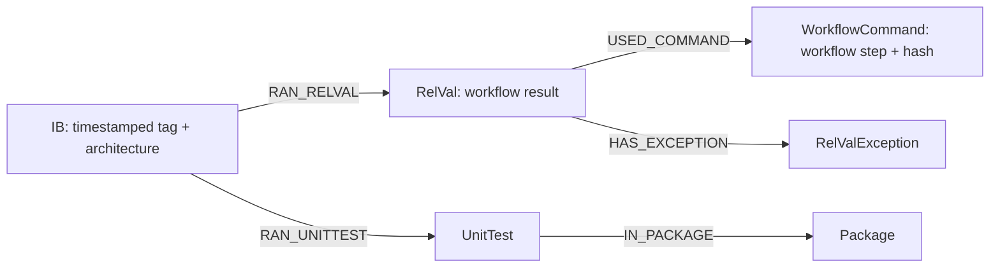
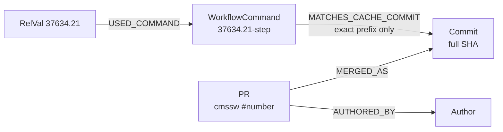

# Current Neo4j Database Structure

## 1. Purpose and Data Boundary

Neo4j stores CMSSDT build evidence and connects it to supplied CMSSW PR data.
The graph is built from local files only:

- `cmsrepo/data/**` for builds, RelVals, unit tests, PR summaries, commands, and status data.
- `cmsrepo/cmssw-prs-cache.json` for the supplied PR-to-commit mapping.
- An optional, separately supplied Issues/PR export for Issue bodies and comments.
- An optional local Clang-log directory for compiler diagnostics.
- Scan results of the raw IB test logs (unit tests, addOn tests, RelVals)
  copied from cmssdt9-02, kept under `/home/rao/CHAT-BOT-AI/IB-TEST-LOGS/results/`.

The importer does not call GitHub. A PR relationship is created only from an
exact commit-hash match in the supplied local files.

## 2. Identity Rules

The following keys prevent records from different builds or architectures from
overwriting each other.

| Record | Unique identity | Example |
| --- | --- | --- |
| Integration Build (`IB`) | `ib_key` = `<timestamped-tag>:<architecture>` | `CMSSW_20_1_X_2026-08-11-2300:el9_amd64_gcc13` |
| RelVal | `key` = `<ib_key>:<workflow-id>` | `...:37634.21` |
| Workflow command | `key` = `<ib_key>:<workflow-id>-<step>` | `...:37634.21-3` |
| PR | `repo` + `number` | `cmssw`, `51668` |
| Commit | `sha` | full supplied commit SHA |
| Issue | `issue_key` = `<repo>:<number>` | `cmssw:12345` |
| Import state | `source_id` | absolute local source path with a type prefix |

## 3. Core CMSSDT Graph



### Primary nodes

| Label | Main properties | Source |
| --- | --- | --- |
| `IB` | `ib_key`, `tag`, `arch`, `release`, `parent_tag`, `variant`, build-status fields | Queue/build, RelVal, or unit-test data |
| `RelVal` | `key`, `workflow_id`, `name`, `status`, `errors`, `warnings` | RelVal JSON |
| `WorkflowCommand` | `key`, `workflow_id`, `workflow_step`, `step`, `command_hash`, `tag`, `arch` | `data/commands` JSON |
| `RelValException` | `key`, `workflow_id`, `text`, `ib_key`, `arch` | RelVal exception JSON |
| `UnitTest` | `key`, `name`, `status`, `errors`, `ok`, `ib_key` | Unit-test JSON |
| `Package` | `name` | Derived from test/warning data |

## 4. Local PR and Command Provenance



### How a workflow reaches a PR

1. The importer reads a workflow-step hash from a local command snapshot.
2. It creates a `WorkflowCommand` node and attaches it to the matching `RelVal`.
3. It reads the full commit SHA from the local PR cache and creates a `Commit` node.
4. It creates `(:PR)-[:MERGED_AS]->(:Commit)`.
5. It creates `(:WorkflowCommand)-[:MATCHES_CACHE_COMMIT]->(:Commit)` only when the command hash exactly equals the first 16 characters of one uniquely matching supplied SHA.
6. The chatbot can report the PR only when this complete path exists.

If a command hash has no supplied cache match, the graph still retains the
workflow command evidence but deliberately reports no mapped PR. For the
currently imported data, workflow `37634.21` has 96 command steps and no exact
match in the supplied PR cache.

## 5. Optional Supplied Issue/PR Export

This layer exists only when the team provides a local archive or directory with
raw `issue.json` and `comments.json` files.

| Label | Important relationships |
| --- | --- |
| `PR` | `AUTHORED_BY` `Author`, `HAS_LABEL` `Label`, `HAS_COMMENT` `GitHubComment`, `REFERENCES` `PR` or `Issue` |
| `Issue` | `AUTHORED_BY` `Author`, `HAS_LABEL` `Label`, `HAS_COMMENT` `GitHubComment`, `REFERENCES` `PR` or `Issue` |
| `GitHubComment` | `AUTHORED_BY` `Author` |
| `Label` | Reusable CMSSW label node |

Textual `REFERENCES` edges mean that a body or comment mentions an item. They
are not evidence that one item caused, fixed, or depends on another item.

## 6. Compiler-Warning Layer

When local Clang logs are imported, the graph additionally has:

```text
(IB)-[:REPORTED]->(Warning)
(IB)-[:HAS_WARNING_IN]->(Package)
(Warning)-[:IN_PACKAGE]->(Package)
(Warning)-[:IN_FILE]->(SourceFile)
(Warning)-[:CHECKED_BY]->(Checker)
(Package)-[:CONTAINS]->(SourceFile)
(SourceFile)-[:FLAGGED_BY]->(Checker)
```

Build-status warning totals on `IB` and parsed individual `Warning` records
are separate evidence types. They must not be summed or treated as equivalent.

## 7. Test-Log Layer

Imported by `ingestion/ingest_test_logs.py` from the results that
`ingestion/fetch_ib_test_logs.py` extracts from the raw log zips (see the
README section "IB test logs"). Its purpose is the problems the dashboard
can't see: an exception, crash or sanitizer report inside a test that is
reported as PASSED.

```text
(IB)-[:HAS_TEST_LOG]->(TestLogRun)
(TestLogRun)-[:HAS_PROBLEM]->(LogProblem)
(LogProblem)-[:HAS_SIGNATURE]->(ProblemSignature)
(ProblemFirstSeen)            -- standalone, keyed by suite|test|signature
```

- `TestLogRun` — one zip of one IB: `suite` is `unit`, `addon` or `relval`;
  `run_variant` is `''` or e.g. `gpu/nvidia_t4` / `other/rntuple` (not the
  same as `IB.variant`). It lists every test or workflow by status
  (`passed_tests`, `failed_tests`, `other_tests`), and RelVal step
  statuses and exit codes for failed workflows (`failed_details`).
- `LogProblem` — one distinct problem found in that zip, with every test or
  workflow step that hit it (`owners`, `owner_statuses`), `in_passed` /
  `in_failed`, `kind`, `category`, `origin` (cmssw / infrastructure /
  unclassified), up to 60 evidence lines, and the zip's `server_path`.
  `serious` is true for exceptions, crashes, sanitizer/UBSan reports,
  assertions, uncaught exceptions, Python tracebacks and infrastructure
  errors. MessageLogger messages and plain error lines are stored grouped.
  The evidence is one example block, but these are collected from every
  occurrence in the zip (scanner v3; for older results the import computes
  them from each test's stored block), so a second producer raising the same
  message is not lost:
  `modules` (`Type/'label'`), `producers` (module types, cfi plugin names,
  source types), `names` (every specific name: quoted names, producers,
  labels, C++/Python identifiers and their scope parts), `context_keys`
  (`<category>|<producer>`, `<category>|exe:<executable>`) and `contexts`
  (the normalized `[N] ...` lines; ones not in the example are appended to
  `text`). The fulltext index `logProblemText` covers `summary` and `text`;
  `logProblemNames` (whitespace analyzer, names matched whole, lowercased)
  covers `names_text` and `context_keys_text`.
- `ProblemSignature` — the same normalized problem across all IBs, with
  `first_seen_tag` / `last_seen_tag`.
- `ProblemFirstSeen` — the first IB in which a serious problem or plain error
  line appeared for one specific test; this is what "new" means for the shifter.

`IB` nodes are never created by this import; a run whose IB isn't imported
yet is linked on a later run. Test statuses come from the logs and are never
changed: a problem in a passed test is reported as exactly that.
`intentional_hint` is text near the problem (for example "intentional") and
only a hint. A problem is treated as expected only after a person confirms it.

## 8. Import Tracking and Updates

Every source file has an `ImportState` node containing:

```text
source_id, source_type, source_path, content_hash, last_ingested_at
```

Refresh behavior:

1. Put the new supplied data into the local `cmsrepo` directory or provide a local Issue/PR archive.
2. Run the incremental importer.
3. Unchanged file hashes are skipped.
4. Changed sources replace the records they own.
5. `--reconcile` removes records belonging to source files no longer present.

Normal local refresh:

```bash
PYTHONPATH=ingestion NEO4J_URI=bolt://localhost:7688 \
venv/bin/python ingestion/build_graph.py --cmsrepo cmsrepo --reconcile
```

For a supplied local Issues/PR archive:

```bash
PYTHONPATH=ingestion NEO4J_URI=bolt://localhost:7688 \
venv/bin/python ingestion/build_graph.py \
  --cmsrepo cmsrepo \
  --github-issues /path/to/export.tar.gz \
  --reconcile
```

By default, command ingestion uses the latest snapshot for each
architecture/release/flavor. `--command-history` imports all historical command
snapshots for a specific investigation.

## 9. Worked Examples

### Example A: A workflow result for one build

Suppose the supplied RelVal data contains workflow `37634.21` for:

```text
IB tag:        CMSSW_20_1_X_2026-08-11-2300
Architecture:  el9_amd64_gcc13
Workflow:      37634.21
Status:        PASSED
```

The importer creates one `IB` node and one `RelVal` node, then connects them:

```text
(IB {tag: 'CMSSW_20_1_X_2026-08-11-2300', arch: 'el9_amd64_gcc13'})
  -[:RAN_RELVAL]->
(RelVal {workflow_id: '37634.21', status: 'PASSED'})
```

The same workflow in another architecture is a separate record. This matters
because one architecture can pass while another fails.

### Example B: A workflow command that maps to a PR

Assume a local command snapshot contains this workflow step:

```text
37634.21-1 -> abcdef1234567890
```

and the supplied local PR cache contains:

```text
PR:         #12345
Commit SHA: abcdef1234567890fedcba9876543210...
```

The first 16 characters match exactly, so Neo4j can establish this evidence
path:

```text
RelVal 37634.21
  -> WorkflowCommand 37634.21-1
  -> Commit abcdef1234567890...
  <- PR #12345
```

The chatbot may then say that the supplied cache maps this workflow command to
PR `#12345`. It should describe this as a cache-backed commit mapping, not as
proof that the PR caused or fixed the workflow result.

### Example C: A workflow command with no supplied PR mapping

The current local data contains 96 `WorkflowCommand` records for workflow
`37634.21`. They represent four workflow steps repeated across 24 IB and
architecture combinations.

Those commands are stored and can be inspected, but none of their hashes has
an exact match in the supplied PR cache. The correct chatbot response is:

```text
The supplied command data contains workflow steps, but the supplied PR cache
does not map their hashes to a PR.
```

It must not guess a PR number, use a similarly named commit, or fetch data from
GitHub.

### Example D: An optional Issue comment

If the team supplies a local Issues/PR export, an Issue comment can be stored:

```text
(Issue #100)-[:HAS_COMMENT]->(GitHubComment)-[:AUTHORED_BY]->(Author)
```

If that comment contains `#12345`, the importer also records a `REFERENCES`
edge to PR `#12345`. This means only that the comment mentions the PR. It does
not prove a dependency, a fix, or a causal relationship.

## 10. Operational Metadata

The same Neo4j instance also contains application metadata:

- `ChatSession` and `ChatTurn` for chat history.
- `UserFeedback` for answer-verdict records.
- `EventOccurrence`, `Build`, `Service`, and `Host` for the Log RAG pipeline.

These records are separate from imported CMSSDT evidence and do not modify the
source-derived nodes above.

## 11. Complete Schema Inventory

This section lists every label with a uniqueness rule in the current Neo4j
schema. A label being available in the schema does not mean its records are
present: optional labels appear only after their matching local source is
imported.

### CMSSDT build and workflow facts

| Label | Unique field | Created from |
| --- | --- | --- |
| `IB` | `ib_key` | Build status, RelVal, unit-test, or Clang import |
| `RelVal` | `key` | Local RelVal JSON |
| `RelValException` | `key` | Local RelVal exception JSON |
| `WorkflowCommand` | `key` | Local command JSON |
| `UnitTest` | `key` | Local unit-test JSON |
| `Package` | `name` | Unit-test or Clang import |
| `Warning` | `key` | Local Clang logs |
| `SourceFile` | `path` | Local Clang logs |
| `Checker` | `name` | Local Clang logs |
| `TestLogRun` | `key` | IB test-log scan results (one zip of one IB) |
| `LogProblem` | `key` | IB test-log scan results (one distinct problem per zip) |
| `ProblemSignature` | `signature_id` | IB test-log scan results (same problem across IBs) |
| `ProblemFirstSeen` | `key` | IB test-log scan results (first IB per test and problem) |

### Supplied PR and Issue facts

| Label | Unique field | Created from |
| --- | --- | --- |
| `PR` | `repo` + `number` | Local PR summary, PR cache, or supplied raw export |
| `Commit` | `sha` | Local PR cache |
| `Issue` | `issue_key` | Optional supplied raw Issue export |
| `GitHubComment` | `key` | Optional supplied raw comment export |
| `PRComment` | `key` | Legacy label retained for compatibility; upgraded to `GitHubComment` during schema setup |
| `Author` | `name` | PR, Issue, or comment data |
| `Label` | `key` | Optional supplied raw Issue/PR export |

### Import and application facts

| Label | Unique field | Purpose |
| --- | --- | --- |
| `ImportState` | `source_id` | Hash, source path, type, and last import time for incremental refreshes |
| `ChatSession` | `session_id` | Stored chat conversation |
| `ChatTurn` | `turn_id` | One user or assistant turn in a conversation |
| `UserFeedback` | `feedback_id` | Answer verdict and verification metadata |

### Log RAG facts

| Label | Unique field | Created from |
| --- | --- | --- |
| `EventOccurrence` | `event_id` | Local/API log payload after normalization |
| `Build` | `tag` | Log RAG event projection when the event supplies a build |
| `Service` | `name` | Log RAG event projection when the event supplies a service |
| `Host` | `name` | Log RAG event projection when the event supplies a host |

## 12. Complete Relationship Inventory

All relationship names below are written in their stored Neo4j direction.

| Source node | Relationship | Target node | Meaning |
| --- | --- | --- | --- |
| `IB` | `RAN_RELVAL` | `RelVal` | The workflow result belongs to this IB and architecture. |
| `RelVal` | `USED_COMMAND` | `WorkflowCommand` | A local command snapshot records this workflow step. |
| `RelVal` | `HAS_EXCEPTION` | `RelValException` | A supplied exception applies to this workflow. |
| `IB` | `RAN_UNITTEST` | `UnitTest` | A unit-test result belongs to this IB and architecture. |
| `UnitTest` | `IN_PACKAGE` | `Package` | The unit test concerns this package. |
| `PR` | `MERGED_AS` | `Commit` | Local PR cache maps this PR to a supplied commit SHA. |
| `WorkflowCommand` | `MATCHES_CACHE_COMMIT` | `Commit` | Exact, unique command-hash prefix match from local files. |
| `PR`, `Issue`, or `GitHubComment` | `AUTHORED_BY` | `Author` | The imported author of the item or comment. |
| `PR` or `Issue` | `HAS_LABEL` | `Label` | A label from the optional supplied raw export. |
| `PR` or `Issue` | `HAS_COMMENT` | `GitHubComment` | A comment from the optional supplied raw export. |
| `PR`, `Issue`, or `GitHubComment` | `REFERENCES` | `PR` or `Issue` | A body/comment textually mentions another item. |
| `IB` | `REPORTED` | `Warning` | Parsed Clang warning evidence for this IB. |
| `IB` | `HAS_WARNING_IN` | `Package` | The IB has one or more parsed warnings in this package. |
| `Warning` | `IN_PACKAGE` | `Package` | The warning belongs to this package. |
| `Warning` | `IN_FILE` | `SourceFile` | The warning points to this source-file path. |
| `Warning` | `CHECKED_BY` | `Checker` | The warning has this compiler checker/flag. |
| `Package` | `CONTAINS` | `SourceFile` | The package contains this imported warning file. |
| `SourceFile` | `FLAGGED_BY` | `Checker` | A checker flagged this file. |
| `IB` | `HAS_TEST_LOG` | `TestLogRun` | The scanned unit/addOn/RelVal log zip of this IB and architecture. |
| `TestLogRun` | `HAS_PROBLEM` | `LogProblem` | A problem found in that zip's logs. |
| `LogProblem` | `HAS_SIGNATURE` | `ProblemSignature` | The normalized problem it is an instance of. |
| `ChatSession` | `HAS_TURN` | `ChatTurn` | A persisted user or assistant message belongs to the chat session. |
| `UserFeedback` | `ABOUT` | `IB` | Feedback explicitly names an IB. |
| `Build` | `CONTAINS_EVENT` | `EventOccurrence` | A normalized Log RAG event belongs to a build. |
| `EventOccurrence` | `EMITTED_BY` | `Service` | A normalized Log RAG event names a service. |
| `EventOccurrence` | `OBSERVED_ON` | `Host` | A normalized Log RAG event names a host. |

## 13. What Counts as a Fact

The chatbot should phrase answers according to the strength of the imported
evidence:

| Imported record | Safe statement |
| --- | --- |
| `RelVal.status` | “This workflow passed/failed for this IB and architecture.” |
| `WorkflowCommand` | “The supplied command snapshot records this workflow step and hash.” |
| `MATCHES_CACHE_COMMIT` plus `MERGED_AS` | “The supplied PR cache maps this command hash to this PR commit.” |
| `REFERENCES` | “The imported text mentions this PR or Issue.” |
| `Warning` | “The local Clang log records this diagnostic at this location.” |
| `LogProblem` with `in_passed` | “This test's log contains this error although the test is reported as passed.” |
| `ProblemSignature.first_seen_tag` | “The first imported log showing this problem is from this IB” (not when it really started: logs exist only from when collection began). |

The following are not established unless a future source provides explicit
evidence: a PR caused a failure, a PR fixed a failure, one item depends on
another, or a missing local item exists remotely.