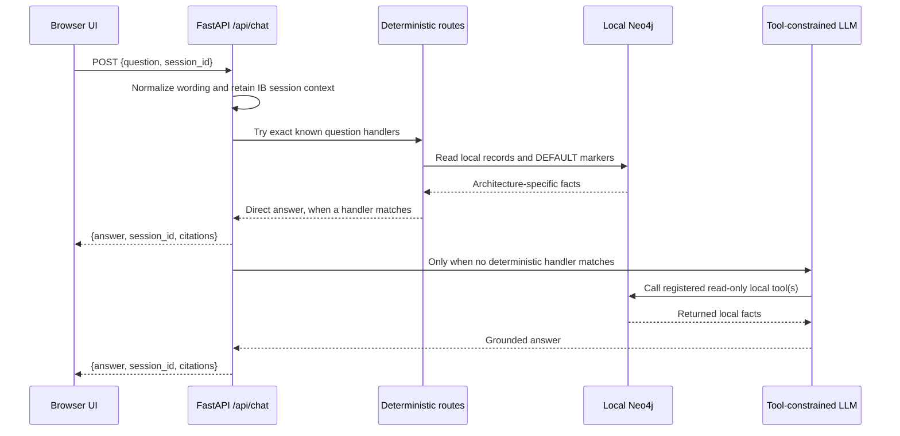

# CMSSDT LLM Knowledge Contract

The chatbot is grounded in local Neo4j facts, not in a static copy of the
database. Its system prompt receives the contract in
`server/knowledge_contract.py`; the `get_database_overview` tool provides
current graph coverage at answer time.

## Scope

- Imported sources are local CMSSW files, local Clang logs, the supplied PR
  cache, and optional local GitHub exports.
- The importer does not call GitHub or download missing data.
- A missing local fact must be reported as missing. The chatbot must not use a
  nearby timestamp, an external source, or inference as a substitute.

## Data Semantics

- An IB record is identified by `tag` and `architecture`; architecture-specific
  facts must remain separate.
- Primary IBs follow `CMSSW_<major>_<minor>_X_<timestamp>`. Variant tags are
  sub-IBs associated with their primary run through `parent_tag`.
- RelVal `errors` and `warnings` are aggregate counters. Unit tests are package
  aggregates. Neither implies a detailed failing test diagnostic.
- PR and Issue text matches are relevance signals only. Exact command-hash to
  cache-commit links preserve provenance, but do not establish causality.

## Answering Rules

1. Use a named graph tool for data questions and inspect its returned facts.
2. Call `get_database_overview` when availability, freshness, or graph coverage
   matters.
3. Use `get_graph_schema` before `query_graph`.
4. State missing, unavailable, or aggregate-only evidence plainly.

## Runtime Prompt

This is the operating instruction supplied to the LLM in addition to the
schema and named tool descriptions:

```text
For a basic CMSSDT question, first identify the exact IB tag, architecture
scope, and category: build, RelVal, UnitTest, Clang, or PR/Issue evidence.

Use only the registered local graph tools and their returned facts. Keep an
exact primary IB exact unless the user explicitly requests variants or all
architectures. When an unqualified IB summary mirrors the CMSSDT UI, use the
locally imported DEFAULT architecture markers. Preserve an explicit
architecture or "all" request.

Give the result first, including its precise scope and totals. State whether
the data is an aggregate and state missing local evidence plainly. Never
invent values, silently broaden scope, use remote GitHub data, or claim a
registered graph tool is unavailable without attempting it.
```

Deterministic API handlers answer common IB questions before this prompt is
used. This avoids an LLM round-trip for questions such as build warnings,
RelVal totals, and UnitTest totals. The prompt governs questions that need a
more general graph lookup.

## Question To Answer Flow



The browser stores `session_id` in session storage and sends it with each
question. The API uses it for bounded chat history and short follow-up context,
such as resolving “and unit tests” to the IB named in the preceding turn. Each
request and answer is persisted as chat metadata in Neo4j; this does not alter
imported CMSSW facts.

## Where Defaults Come From

`DEFAULT` is data, not a list embedded in the chatbot. During local ingestion,
the availability files define the plain architecture descriptors for each tag.
Specialized descriptors are excluded, while plain descriptors are stored on IB
nodes as default markers. The deterministic build, RelVal, and UnitTest
handlers use those markers for unqualified UI-style questions. An explicit
architecture or `all` overrides that default selection.