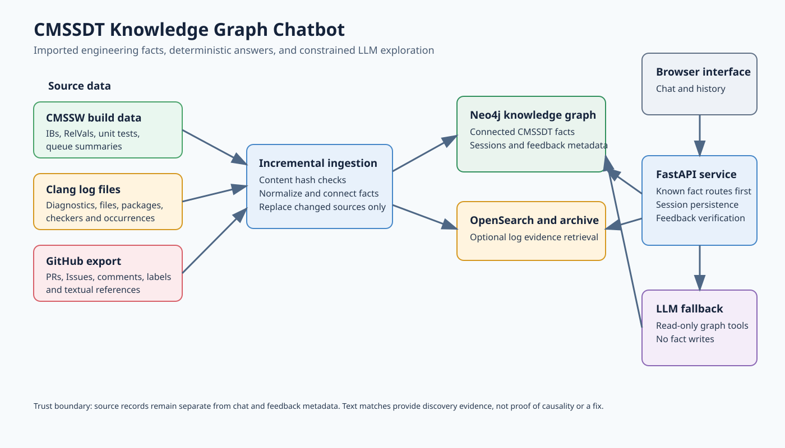
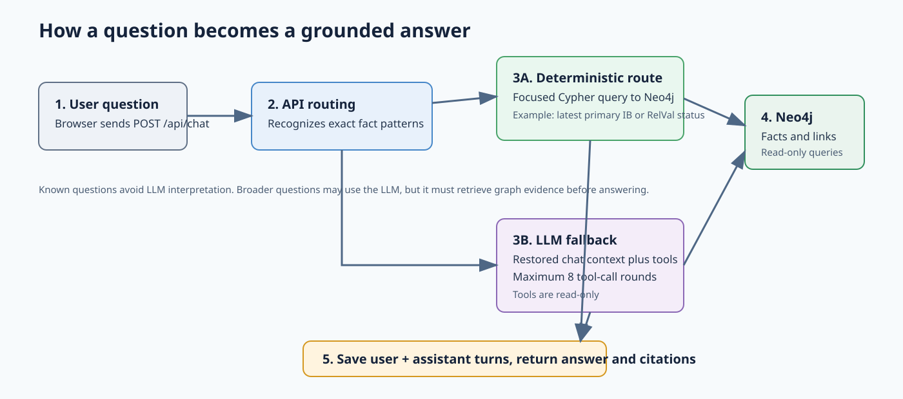

# CMSSDT Knowledge Graph Chatbot

## Meeting Briefing and Implementation Guide

This document explains the current CMSSDT chatbot in plain language first,
then describes the implementation in enough detail for technical discussion.
It is based on the code and the currently imported Neo4j graph. It does not
contain credentials or private configuration values.



## 1. What the system does

CMSSDT information is normally spread across Integration Build dashboards,
RelVal and unit-test results, Clang logs, and GitHub discussions. This project
collects those sources into a Neo4j knowledge graph and provides a chat-style
interface for asking questions about them.

The important distinction is that this is not a chatbot that merely "knows"
CMSSDT data from training. It reads imported facts from the graph at answer
time. For common factual questions it uses deterministic database queries. For
broader questions it can use a language model, but the model is restricted to
read-only graph tools.

### What a user gets

- One interface for build, RelVal, unit-test, warning, PR, and Issue questions.
- Answers grounded in imported records rather than invented values.
- Clear distinction between a fact, a textual match, and an unsupported causal
  conclusion.
- Conversation history that survives an API restart for the same browser tab.
- Feedback recording with automated verification where graph evidence is enough.

## 2. The system in everyday language

Think of Neo4j as a connected filing cabinet. Instead of placing build results,
compiler diagnostics, and GitHub records into isolated tables, it stores the
connections between them. For example, an Integration Build is connected to its
RelVals, unit tests, and warnings. A GitHub Issue is connected to its comments,
labels, and author.

When someone asks a question, the system first checks whether it recognizes a
reliable question type. If so, it runs the appropriate database query and
formats the answer. If the question is broader, it sends the question to the
LLM together with a limited set of read-only tools. The LLM must call those
tools before answering a data question.

This gives the interface natural-language flexibility without allowing the LLM
to write to production facts or silently invent counts.

## 3. From interface to answer



### Step-by-step request path

1. A user enters a question in the browser chat page.
2. The browser sends `POST /api/chat` with the question and a session ID.
3. FastAPI checks deterministic routes first. These are Python functions that
   recognize known question shapes and query Neo4j directly.
4. If a deterministic route answers the question, the API saves both the user
   question and answer as `ChatTurn` records and returns the result.
5. If no deterministic route applies, the API restores recent conversation
   context and gives the question to the LLM agent.
6. The agent can call named read-only graph tools. Its tools cannot create,
   update, or delete imported graph data.
7. The API saves the final answer and returns it to the browser. The browser
   renders the message and any evidence citations.

### Why deterministic routes come first

Many CMSSDT questions have an exact meaning. A database query is more reliable
than asking a language model to infer that meaning. Current deterministic
examples include:

- Latest primary Integration Build lookup.
- Build-status warning lookup for a named IB.
- Clang warning counts by package.
- RelVal error-counter breakdown for a named IB.
- Two-IB comparison across architectures.
- Exact PR, Issue, and failed-RelVal follow-up flows.

The LLM remains useful for open-ended questions, but it is the second choice
for known factual patterns.

## 4. Integration Build model

### Primary runs and sub-IBs

A primary Integration Build has this form:

```text
CMSSW_<major>_<minor>_X_<timestamp>
```

Example:

```text
CMSSW_20_1_X_2026-08-10-2300
```

A sub-IB inserts a variant before `_X_`:

```text
CMSSW_20_1_NONLTO_X_2026-08-10-2300
CMSSW_20_1_CLANG_X_2026-08-10-2300
CMSSW_20_1_UBSAN_X_2026-08-10-2300
```

The importer does not contain a fixed list of variants. It derives a
`parent_tag` and optional `variant` from the general tag structure. This means
new variants are grouped automatically. The primary run, its sub-IBs, and each
architecture are still stored as separate graph records so their results cannot
overwrite one another.

### Example: "What is the latest IB?"

The system selects only primary tags when deciding what "latest IB" means. It
then lists recorded sub-IB variants below the primary run. A variant such as
`CMSSW_20_1_NONLTO_X_...` is not mistakenly presented as a separate main run.

If several primary release families share the newest timestamp, the answer
lists them rather than arbitrarily selecting one.

## 5. RelVal example: why counters and failures differ

Question:

```text
How many RelVal errors are in CMSSW_20_1_EVTGEN3_X_2026-08-09-2300?
```

For the imported `el9_amd64_gcc13` data, the dashboard shows 13 failed RelVals.
The graph also stores an `errors` counter for every RelVal step. Summing that
counter gives 100,777, but that number is not a count of failed workflows:

| Meaning | Value |
| --- | ---: |
| RelVal records | 950 |
| RelVals whose final status is `FAILED` | 13 |
| Aggregate step-error counters from failed RelVals | 126 |
| Aggregate step-error counters from `PASSED` RelVals | 100,651 |
| Aggregate step-error counters across all RelVals | 100,777 |

The chatbot now explains this distinction. The correct plain-language answer
is: there are 13 failed workflows; 100,777 is an aggregate diagnostic counter
that includes entries from workflows whose final status was `PASSED`.

## 6. Data ingestion pipeline

The importer is incremental. It calculates a content hash for every source
unit and records the hash in an `ImportState` node.

1. If a source file did not change, it is skipped.
2. If a source file changed, only the records owned by that source are replaced.
3. With `--reconcile`, records from source files that disappeared are removed.
4. A full refresh is available with `--force`, but is not required for normal
   updates.

### Imported sources

| Source | Imported facts |
| --- | --- |
| `cmsrepo/data` | IBs, RelVals, unit tests, queue/build status, aggregate PR data |
| Raw CMSSW GitHub export | PRs, Issues, comments, labels, authors, textual references |
| External Clang `log.html` files | Parsed diagnostics, package/file/checker relationships |
| Log RAG API payloads | Archived event data with checksum and provenance |

### Important warning distinction

There are two different warning domains:

| Name | Source | What it measures |
| --- | --- | --- |
| Build-status warnings | CMS queue summary | Per-IB/per-architecture summary counts |
| Parsed Clang warnings | Individual Clang logs | Diagnostic locations and occurrence counts |

They are intentionally not added together. They answer different questions.

## 7. Graph data model

The main graph nodes are:

```text
IB, RelVal, UnitTest, Warning, Package, SourceFile, Checker,
PR, Issue, GitHubComment, Label, Author, ChatSession, ChatTurn
```

Representative relationships:

```text
(IB)-[:RAN_RELVAL]->(RelVal)
(IB)-[:RAN_UNITTEST]->(UnitTest)
(IB)-[:REPORTED]->(Warning)
(Warning)-[:IN_PACKAGE]->(Package)
(PR|Issue)-[:HAS_COMMENT]->(GitHubComment)
(PR|Issue)-[:HAS_LABEL]->(Label)
(PR|Issue)-[:REFERENCES]->(PR|Issue)
(ChatSession)-[:HAS_TURN]->(ChatTurn)
```

An `IB` identity includes both the tag and architecture. This prevents one
platform's results from replacing another platform's results for the same tag.

## 8. LLM safety and evidence boundaries

The system is designed to distinguish discovery evidence from proof.

- A PR changing the same file as a warning is useful relevance evidence, not
  proof that the PR introduced the warning.
- A GitHub title/body/comment text match helps find relevant Issues, but does
  not prove causality, a dependency, a fix, or a merge reason.
- The LLM may only use read-only named tools or read-only Cypher. Write
  keywords are rejected.
- Imported scientific, build, and GitHub facts are not overwritten by user
  feedback or the LLM.

## 9. Conversation history and feedback

### Conversation history

Each chat session has a `ChatSession` node and ordered `ChatTurn` nodes in
Neo4j. The API restores the most recent 12 turns when creating a new in-memory
LLM session. Deterministic answers are also remembered, so a later natural
follow-up can use them.

The browser restores history after refresh in the same tab. It uses
`sessionStorage`, so closing the tab or opening a new tab does not currently
restore the old session ID. The data remains in Neo4j and can be exported using
the API.

### Feedback

`POST /api/feedback` records a user's correctness verdict without changing
imported facts. Latest-IB feedback is verified deterministically. Other
feedback can be verified by a separate LLM session with read-only graph tools.
The result is recorded as `accepted`, `rejected`, or `pending` with a
verification method.

## 10. API reference

| Endpoint | Purpose |
| --- | --- |
| `GET /api/health` | Service readiness and configured capabilities |
| `POST /api/chat` | Main chat question endpoint |
| `GET /api/chat/{session_id}/history` | Saved conversation turns |
| `GET /api/chat/{session_id}/export.md` | Markdown conversation export |
| `DELETE /api/chat/{session_id}` | Clear in-memory and saved conversation history |
| `POST /api/feedback` | Record and verify answer feedback |
| `POST /api/ingest` | Archive and project Log RAG events |
| `POST /api/search` | Retrieve inspectable Log RAG evidence without an LLM |

Example request:

```json
{
  "question": "How many RelVal errors are in CMSSW_20_1_EVTGEN3_X_2026-08-09-2300?",
  "session_id": "optional-browser-session-id"
}
```

Example response shape:

```json
{
  "answer": "...",
  "session_id": "...",
  "citations": []
}
```

## 11. Deployment and refresh

The production-style local stack is managed by Compose:

```text
Browser -> API (host port 8002) -> Neo4j / OpenSearch
```

The API container exposes port 8001 internally and is published on host port
8002 by default. After source changes, rebuild and restart the API service:

```bash
podman compose up -d --build api
```

Use `docker compose` instead when Docker is the configured container runtime.
After restart, check:

```bash
curl http://localhost:8002/api/health
```

## 13. Current boundaries and next improvements

- Browser recovery is currently same-tab only; `localStorage` or authenticated
  ownership would enable longer-lived recovery.
- In-memory LLM tool transcripts are not yet summarized or pruned during very
  long active sessions.
- Feedback records store a verdict and reason; persisting each verifier tool
  result as provenance would improve auditability.
- The graph reports imported facts. It should not be used to infer unrecorded
  causal claims about PRs, warnings, or failures.

## 14. File map for technical follow-up

| File | Responsibility |
| --- | --- |
| `server/static/index.html` | Browser chat interface and history restoration |
| `server/api_server.py` | API endpoints, deterministic routes, session storage, feedback |
| `server/agent.py` | LLM tool-calling loop |
| `graph/tools.py` | Read-only named graph tools and schema description |
| `graph/neo4j_conn.py` | Neo4j connection, constraints, indexes, IB metadata backfill |
| `ingestion/build_graph.py` | Incremental graph importer and IB parent/sub-IB derivation |
| `docker-compose.yml` | Neo4j, OpenSearch, Logstash, and API deployment |
